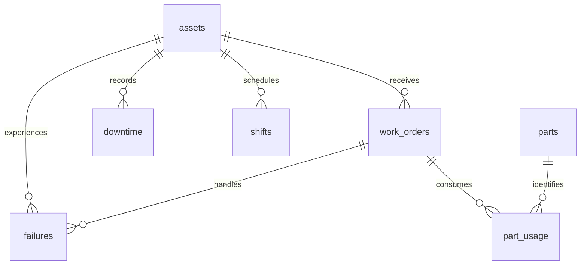

# Contratos de datos y métricas

## Modelo relacional

| Tabla | Grano | Clave / regla |
|---|---|---|
| assets | Un activo | ID y nombre únicos; criticidad 1–3 |
| work_orders | Una orden | Activo válido; prioridad 1–3; cierre y cancelación excluyentes; vencimiento/cierre no anteriores a apertura |
| failures | Un evento de falla | FK compuesta exige que la orden corresponda al mismo activo; restauración posterior al inicio |
| downtime | Un reporte de parada | Fin posterior al inicio o abierto; solapamientos permitidos y unidos al consultar |
| shifts | Un turno por activo | Duración positiva; no solapamientos en inserciones ni actualizaciones |
| parts | Un repuesto | Nombre único |
| part_usage | Una transacción de consumo | Cantidad positiva y costo unitario histórico en centavos enteros no negativos |

Tablas STRICT y claves foráneas activadas en cada conexión del proyecto. Los triggers creados en `core.connect()` validan fechas canónicas y turnos; se preservan al exportar la base y no necesitan funciones Python para funcionar. Para escribir desde otra herramienta, activar `PRAGMA foreign_keys=ON`: SQLite lo configura por conexión. El cargador usa una transacción; un error revierte el escenario completo.

## Tiempo y denominadores

UTC en texto `YYYY-MM-DD HH:MM:SS`, sin desfase horario ni cambios estacionales. Períodos y paradas semiabiertos `[inicio, fin)`. Los timestamps se normalizan y comparan con su forma original para rechazar fechas inexistentes o formatos ambiguos. Un estado cerrado/cancelado exactamente al corte ya no es backlog; una orden abierta exactamente al corte aún no entra al snapshot.

- **Paradas:** unión por activo antes de sumar, recortada al período. Usa el máximo final de todos los intervalos anteriores: LAG del último fin falla con intervalos anidados. Los intervalos abiertos se recortan al fin de consulta. No se reparte una unión entre causas porque las causas pueden superponerse.
- **MTTR:** promedio de horas desde inicio a restauración en fallas que comenzaron dentro del período y tienen restauración observada al corte. Se muestran iniciadas, restauradas y censuradas. No se reemplaza duración desconocida por cero ni se afirma que los completados representen los abiertos. La restauración es distinta del cierre administrativo de la orden.
- **Backlog:** toda orden iniciada antes del corte sin cierre/cancelación a ese momento; incluye aperturas anteriores al inicio del reporte. Edad desde apertura; vencida si su fecha límite es anterior al corte. Prioridad y antigüedad se conservan como criterios distintos.
- **Repuestos:** cantidad × precio unitario registrado en cada transacción; se suma sin un JOIN que multiplique filas por eventos de falla. USD sintéticos; todos los cálculos de costo base son enteros. Denominador cero produce participación desconocida.
- **Disponibilidad programada:** `(horas programadas - parada dentro de turnos) / horas programadas`. Incluye paradas planificadas y no planificadas. Los turnos no se solapan por activo. Sin turnos, resultado nulo. No es OEE y no representa disponibilidad fuera del calendario.

## Referencias y alcance

Las definiciones anteriores son el contrato explícito de esta demostración; no se atribuye certificación industrial. Implementación de ventanas, tipos y planes basada en documentación oficial: [funciones de ventana](https://www.sqlite.org/windowfunctions.html), [tablas STRICT](https://www.sqlite.org/stricttables.html), [EXPLAIN QUERY PLAN](https://www.sqlite.org/eqp.html). Los planes cambian según motor y datos y no sirven como prueba automática de rendimiento.

Para datos reales: acordar taxonomía de fallas, cobertura de sensores, calendario y zona horaria, fuente de costos, fechas de detección/restauración y reglas de cancelación; contrastar con mantenimiento antes de utilizar resultados operativos.
